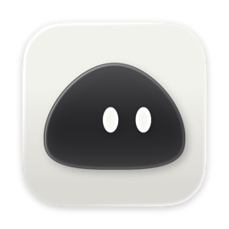

<div align="center">
    
    <h1>Mira</h1>
    <p>
        An automation client for AdventureQuest Worlds on Apple silicon Macs.
    </p>
    <a href="https://usemira.pages.dev">Documentation</a>
    ·
    <a href="https://github.com/toommyliu/mira/releases">Releases</a>
</div>

## Download

Requires macOS 26 or later.

> [!NOTE]
> Mira is early, so expect rough edges. Please open an issue for anything that
> hasn't been reported yet.

Download `Mira.dmg` from the
[latest release](https://github.com/toommyliu/mira/releases/latest) and drag
Mira into Applications.

Mira runs the game in a [fork of Ruffle](https://github.com/toommyliu/ruffle)
embedded in the app. That fork is optimized for Apple silicon, so Mira won't
support other platforms.

Releases aren't notarized, so macOS blocks the first launch. Open Mira once,
then go to System Settings > Privacy & Security and click Open Anyway.

After that, Mira can update itself without macOS blocking it again.

## Scripts

A script is a TypeScript generator function.

```ts
import { Combat, Player, Script } from "mira";

export default function* () {
  if (!(yield* Player.isReady())) return;
  while (true) {
    const prey = yield* Combat.hunt("Frogzard");
    if (prey === null) {
      yield* Script.sleep("2 seconds");
      continue;
    }
    yield* Combat.kill({ monMapId: prey.monMapId });
  }
}
```

The [docs](https://usemira.pages.dev) cover the full API, and
[examples](examples) has very basic uses for it.

## Disclaimer

Mira is an unofficial client, provided for educational purposes only. Use at
your own risk.
